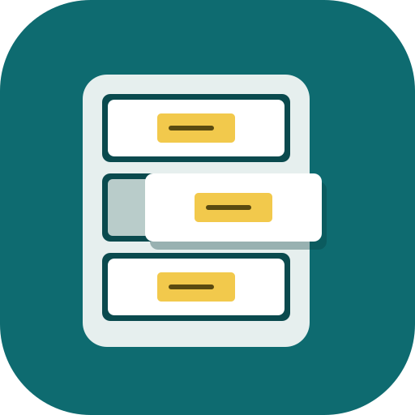
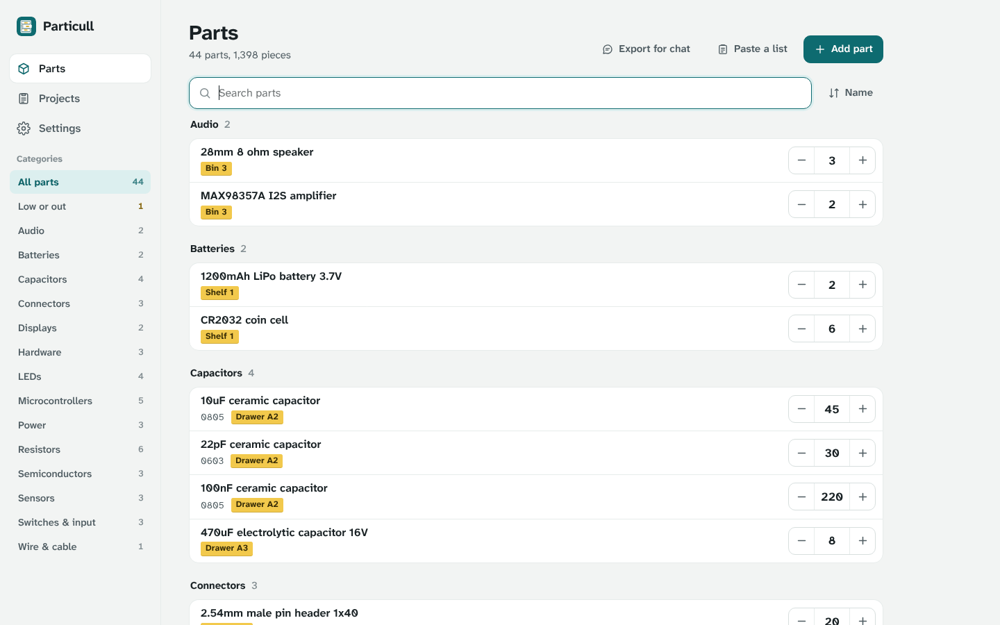
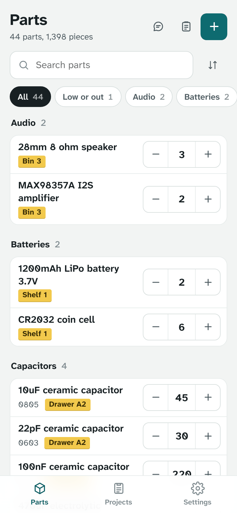
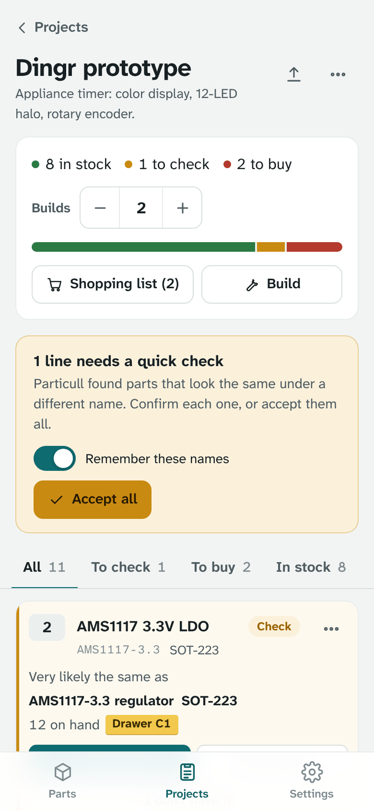
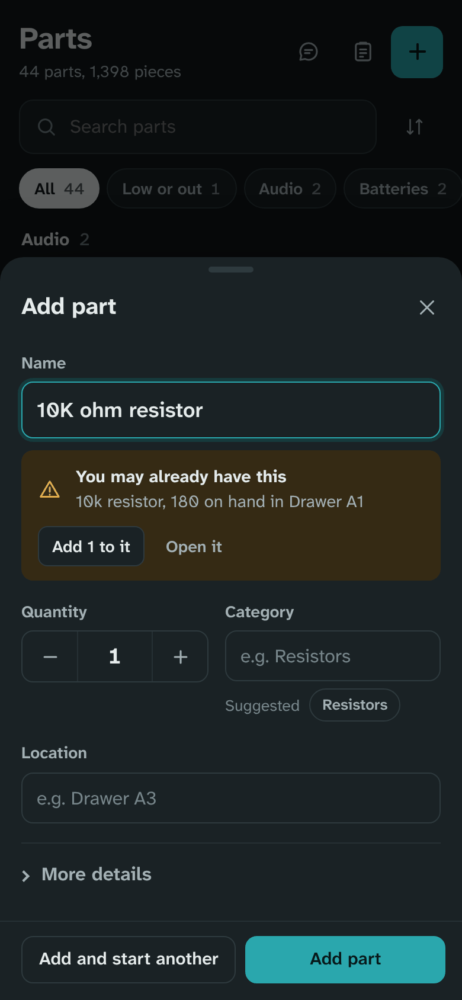
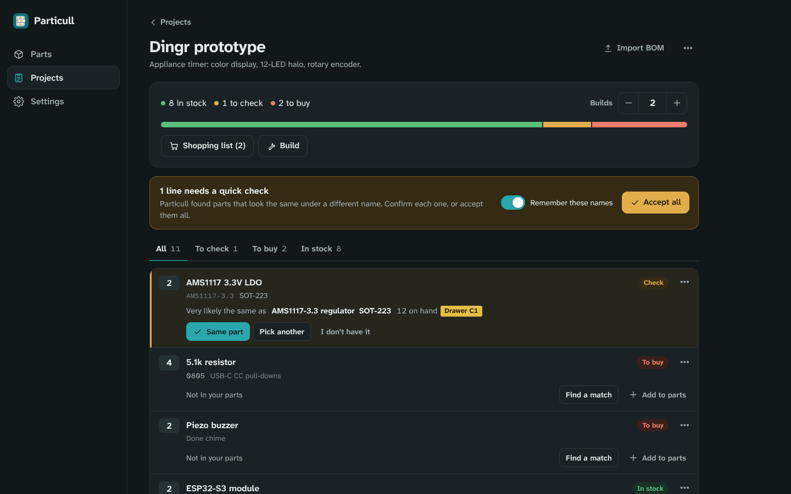

<p align="center"></p>

# Particull

A simple, self-hosted parts inventory for makers. Keep track of the microcontrollers, passives and odds and ends in your drawers, then paste in a project's bill of materials and see what you have, what needs a quick check, and what to buy.

It is a ground-up rebuild of [Binner](https://github.com/replaysMike/Binner), cut down to what a hobby bench needs: no supplier accounts, no order imports, no forms full of parameters.



<p>
  
  
  
</p>

## What it does

- **Fast hand entry.** A part needs a name and a quantity. Category and location are optional, autocomplete from what you've used, and carry over to the next part so a run of resistors goes quickly. Package, part number, notes, link and a low-stock warning sit behind "More details".
- **Catches duplicates while you type.** Start typing "10K ohm resistor" and it points out the "10k resistor" you already have, with a button to add to that one instead.
- **Paste a list.** Lines like `10x 10k resistor 0805`, `ESP32-S3 dev board ×2`, a Markdown table or a CSV all work. You get a preview, and rows that match an existing part can be added to it.
- **Projects check a BOM against your parts.** Import a BOM (Markdown table, CSV, KiCad BOM export, or one part per line) and every line comes back as in stock, short, to buy, or to check. Set how many you're building and the quantities follow.
- **Near-matches are flagged for you to approve.** "10K ohm res", "R 10k" and "10kΩ resistor" are recognised as your "10k resistor"; "0.1uF" matches "100nF"; "AMS1117 3.3V LDO" matches "AMS1117-3.3 regulator". Different values (10k vs 4.7k), types (resistor vs potentiometer) or voltages are never suggested, and a package mismatch is shown as a warning. Approving a match can remember the BOM's wording as another name for the part, so next time it matches on its own.
- **Shopping list and builds.** Copy or download what's missing. When the order arrives, "I got these" adds it all to your parts, creating any that are new. "Build" takes a project's parts out of inventory, with undo.
- **Export for chat.** One click gives you your inventory as a compact Markdown list to paste into a chat with Claude, with a note asking for any BOM in the table format Particull imports.
- **Cost tracking is off by default.** Turn it on in Settings to get a unit cost per part, an inventory total and project cost estimates. Off, prices are nowhere in the interface.
- Works well on a phone: bottom navigation, bottom sheets, large steppers. Light and dark themes.



## Using it with Claude

1. On the **Parts** page, choose **Export for chat** and copy the text.
2. Paste it into a chat and describe what you want to build. The export already asks for the BOM as a `Qty | Part | Part number | Package | Notes` table, using your part names where you have them.
3. Create a project and paste the table into **Bill of materials** (or **Import BOM** on an existing project).
4. Review the lines marked **To check**, then use the shopping list for the rest.

If you're starting a chat without the export, **Copy BOM instructions for Claude** in the import sheet gives you just the format request.

## Run it

```sh
docker compose up -d --build
```

Then open `http://<server>:8097`.

`docker-compose.yml` builds the image from this folder. Once the GitHub workflow has published it, remove the `build: .` line to pull `ghcr.io/au12/particull:latest` instead.

To run without Docker you need Node 22.13 or newer (for the built-in SQLite module):

```sh
cd app
npm start            # http://localhost:8080, data in app/data
npm test
node scripts/seed-demo.js http://localhost:8080   # optional sample parts and projects
```

There are no npm dependencies to install.

## Unraid

Either use the compose file with the Compose Manager plugin, or add it as a regular container:

1. Copy `unraid/particull.xml` to `/boot/config/plugins/dockerMan/templates-user/my-particull.xml`.
2. In **Docker → Add Container**, choose the **particull** template.
3. Keep **Data** at `/mnt/user/appdata/particull` and **PUID/PGID** at `99`/`100`, and apply.

If the GHCR package is private (it is by default when the repo is private), log in once from the Unraid terminal so it can pull:

```sh
docker login ghcr.io -u au12    # password: a GitHub token with read:packages
```

## Nginx Proxy Manager

Add a proxy host, for example `parts.yourdomain`:

- **Scheme** `http`, **Forward hostname/IP** your Unraid address, **Forward port** `8097`.
- On the **SSL** tab, request a certificate and turn on **Force SSL**.
- Set `TRUST_PROXY=true` on the container. If the host is reachable from the internet, also set `PASSWORD`.

## Settings

| Variable | Default | What it does |
| --- | --- | --- |
| `PORT` | `8080` | Port inside the container. |
| `DATA_DIR` | `/data` | Where the database lives. Map it to a host folder. |
| `PUID` / `PGID` | `1000` / `1000` | Owner of the database file. Use `99` / `100` on Unraid. |
| `PASSWORD` | empty | Empty means anyone who can reach the page can use it. Set one to require sign-in. Sessions last 90 days; changing the password signs everyone out. |
| `TRUST_PROXY` | `false` | Set to `true` behind a reverse proxy so the sign-in cookie is marked secure and login limits use the real client address. |
| `TZ` | UTC | Time zone for dates in exports and backup file names. |

Cost tracking, theme and chat export defaults are set in the app under **Settings**.

## Data and backups

Everything is in one SQLite file, `/data/particull.db` (with its `-wal` and `-shm` companions while running). Back up the `/data` folder, or use **Settings → Download backup** for a single JSON file with all parts, projects and settings. **Restore a backup** replaces everything with the file's contents.

**Settings → Import parts from a CSV** opens a spreadsheet export in the paste preview, so you can bring an existing list across. Column names like Qty, Name, Part number, Package, Category and Location are recognised.

## BOM formats

Particull reads whatever you paste and works out the shape:

- **Markdown tables** with any of these columns: Qty/Quantity, Part/Name/Item, Value, Part number/MPN, Package/Footprint, References/Designators, Notes/Description. Surrounding text and a Total row are ignored.
- **CSV, TSV or semicolon files** with a header row. KiCad BOM exports work: `10k` with reference `R1` becomes "10k resistor", and footprints like `R_0805_2012Metric` become `0805`.
- **Plain lists**, one part per line: `10x 10k resistor`, `10 x …`, `×10`, `(x10)`, `name, 10`, `10 pcs …`. Bullets and checkboxes are stripped. A heading or a line like `Passives:` sets the category for the lines under it. Lines without a quantity count as 1 and are marked in the preview.

## How it's built

One Node process using only built-in modules: `node:http` for the server and `node:sqlite` for storage. The web app is plain JavaScript modules with no build step. Part matching (unit and value normalisation, synonyms, package codes, part-number similarity) lives in `app/public/shared/match.js` and runs on the server; the same parser is shared with the browser.

```
app/server.js            HTTP API, static files, optional password
app/db.js                schema, parts, projects, BOM lines, builds, backups
app/export.js            chat export, shopping list, BOM export
app/public/shared/       BOM/list parser and fuzzy matcher
app/public/js/           the web app
unraid/particull.xml     Unraid container template
```

## License

GPL-3.0, the same as Binner, which this project started from. Fonts are Atkinson Hyperlegible Next and Atkinson Hyperlegible Mono by the Braille Institute, under the SIL Open Font License (`app/public/fonts/OFL.txt`).
