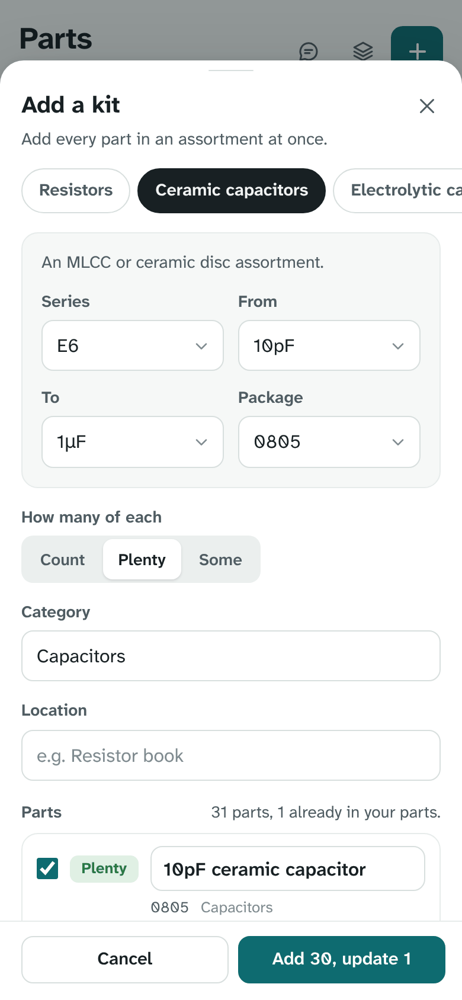
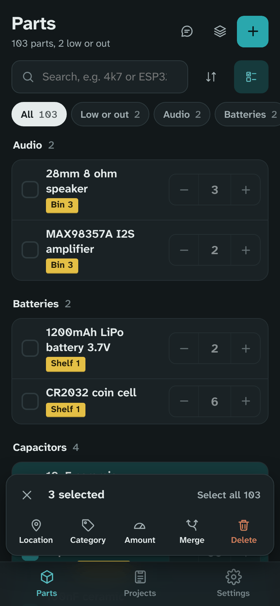
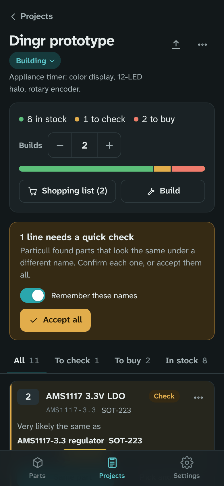

<p align="center"></p>

# Particull

A simple, self-hosted parts inventory for makers. Keep track of the microcontrollers, passives and odds and ends in your drawers, then paste in a project's bill of materials and see what you have, what needs a quick check, and what to buy.

It is a ground-up rebuild of [Binner](https://github.com/replaysMike/Binner), cut down to what a hobby bench needs: no supplier accounts, no order imports, no forms full of parameters.


<p>
  
  
  
  
</p>

## What it does

- **Fast hand entry.** A part needs a name and an amount. Category and location are optional, autocomplete from what you've used, and carry over to the next part so a run of similar parts goes quickly. Package, part number, notes, link and a low-stock warning sit behind "More details".
- **Count it, or don't.** Each part is either counted exactly or marked **Plenty**, **Some**, **Running low** or **Out**. Nobody counts 0805 resistors; BOM checks treat Plenty and Some as in stock and list Running low as something to top up.
- **Units.** Count pieces by default, or metres of wire, grams of filament, spools, packs. Amounts can be fractional.
- **Add a whole kit at once.** Resistors (E6/E12/E24 over any range and package), ceramic and electrolytic capacitors, LEDs by size and color, JST/Dupont/screw-terminal connectors, common diodes and transistors, and metric screws or standoffs. Pick the options, see the parts, untick what you don't have.
- **Catches duplicates while you type.** Start typing "10K ohm resistor" and it points out the "10k resistor" you already have, with a button to add to that one instead.
- **Paste a list.** Lines like `10x 10k resistor 0805`, `ESP32-S3 dev board ×2`, a Markdown table or a CSV all work. You get a preview, and rows that match an existing part can be added to it.
- **Change many parts at once.** Tap **Select** (or long-press a part on a phone), pick parts, then move them to a location, set a category, change how they're counted, merge duplicates or delete them, with undo.
- **Merge duplicates.** Two entries for the same part become one: amounts add up, the other name is kept so BOMs still match, and project lines follow.
- **Search understands values.** `4k7` finds "4.7k resistor", `0.1u` finds "100nF", `3v3` finds 3.3V regulators.
- **Projects check a BOM against your parts.** Import a BOM (Markdown table, CSV, KiCad BOM export, or one part per line) and every line comes back as in stock, short, to buy, or to check. Set how many you're building and the quantities follow.
- **Near-matches are flagged for you to approve.** "10K ohm res", "R 10k" and "10kΩ resistor" are recognised as your "10k resistor"; "0.1uF" matches "100nF"; "AMS1117 3.3V LDO" matches "AMS1117-3.3 regulator". Different values (10k vs 4.7k), types (resistor vs potentiometer) or voltages are never suggested, and a package mismatch is shown as a warning. Approving a match can remember the BOM's wording as another name for the part, so next time it matches on its own.
- **Shopping list and builds.** Copy or download what's missing. When the order arrives, "I got these" adds it all to your parts, creating any that are new. "Build" takes a project's parts out of inventory, with undo.
- **Project status and archive.** Projects are Ideas, Planned, Building or Done, grouped that way in the list. Archive finished ones to get them out of the way.
- **Export for chat.** One click gives you your inventory as a compact Markdown list to paste into a chat with Claude, with a note asking for any BOM in the table format Particull imports. Runs of plain resistors and capacitors collapse to one line each, like `Resistors, 0805: E12 series 10Ω–1M (61 values); plenty of each`, which roughly halves the size of a real inventory.
- **Automatic backups.** Daily by default, or every 6 hours or weekly, keeping as many as you choose. Every restore saves a copy first, so a bad restore can be undone.
- **Opens instantly, works on bad Wi-Fi.** Installed to your home screen, it opens from a saved copy and shows the last data it saw when the server can't be reached.
- **Cost tracking is off by default.** Turn it on in Settings to get a unit cost per part, an inventory total and project cost estimates. Off, prices are nowhere in the interface.
- Works well on a phone: bottom navigation, bottom sheets, large steppers. Light and dark themes.


## Using it with Claude

1. On the **Parts** page, choose **Export for chat** and copy the text.
2. Paste it into a chat and describe what you want to build. The export already asks for the BOM as a `Qty | Part | Part number | Package | Notes` table, using your part names where you have them.
3. Create a project and paste the table into **Bill of materials** (or **Import BOM** on an existing project).
4. Review the lines marked **To check**, then use the shopping list for the rest.

If you're starting a chat without the export, **Copy BOM instructions for Claude** in the import sheet gives you just the format request.

## Run it

```sh
docker compose up -d --build
```

Then open `http://<server>:8097`.

`docker-compose.yml` builds the image from this folder. Once the GitHub workflow has published it, remove the `build: .` line to pull `ghcr.io/au12/particull:latest` instead.

To run without Docker you need Node 22.13 or newer (for the built-in SQLite module):

```sh
cd app
npm start                                  # http://localhost:8080, data in app/data
npm run seed -- http://localhost:8080      # optional sample parts and projects
```

The app itself has no npm dependencies. The browser tests and screenshot script use `puppeteer-core` with the Chrome you already have:

```sh
npm install
npm test                                   # unit and API tests
npm run test:e2e                           # the main flows in headless Chrome
npm run screenshots -- http://localhost:8080 ../docs/screenshots
```

Set `CHROME_PATH` if Chrome isn't found.

## Unraid

Either use the compose file with the Compose Manager plugin, or add it as a regular container:

1. Copy `unraid/particull.xml` to `/boot/config/plugins/dockerMan/templates-user/my-particull.xml`.
2. In **Docker → Add Container**, choose the **particull** template.
3. Keep **Data** at `/mnt/user/appdata/particull` and **PUID/PGID** at `99`/`100`, and apply.

If the GHCR package is private (it is by default when the repo is private), log in once from the Unraid terminal so it can pull:

```sh
docker login ghcr.io -u au12    # password: a GitHub token with read:packages
```

## Nginx Proxy Manager

Add a proxy host, for example `parts.yourdomain`:

- **Scheme** `http`, **Forward hostname/IP** your Unraid address, **Forward port** `8097`.
- On the **SSL** tab, request a certificate and turn on **Force SSL**.
- Set `TRUST_PROXY=true` on the container. If the host is reachable from the internet, also set `PASSWORD`.

Opening instantly and the offline copy need HTTPS (browsers only allow them on secure pages), so they work through the proxy but not on a plain `http://192.168…` address. Everything else works either way.

## Settings

| Variable | Default | What it does |
| --- | --- | --- |
| `PORT` | `8080` | Port inside the container. |
| `DATA_DIR` | `/data` | Where the database lives. Map it to a host folder. |
| `PUID` / `PGID` | `1000` / `1000` | Owner of the database file. Use `99` / `100` on Unraid. |
| `PASSWORD` | empty | Empty means anyone who can reach the page can use it. Set one to require sign-in. Sessions last 90 days; changing the password signs everyone out. |
| `TRUST_PROXY` | `false` | Set to `true` behind a reverse proxy so the sign-in cookie is marked secure and login limits use the real client address. |
| `TZ` | UTC | Time zone for dates in exports and backup file names. |

Cost tracking, theme, backup schedule and chat export defaults are set in the app under **Settings**.

## Data and backups

Everything is in one SQLite file, `/data/particull.db` (with its `-wal` and `-shm` companions while running).

**Settings → Backups** keeps copies of that file in `/data/backups`:

- Scheduled backups run daily at 3:00 AM by default (container time zone). Choose every 6 hours, daily, weekly or off, the hour, and how many to keep.
- **Back up now** makes one by hand. Those are kept until you delete them.
- A copy is saved automatically before every restore, labeled "Before a restore".
- Any backup can be restored, downloaded or deleted from the list, and **Restore from a .db file** takes a backup from somewhere else.

Each backup is a complete SQLite database, so you can also open one with any SQLite tool. Include `/data` in your Unraid backup (Appdata Backup or similar) for copies off the server.

**Settings → Move your data** downloads everything as JSON, restores from that JSON, and imports a CSV of parts into the paste preview, so you can bring an existing list across. Column names like Qty, Name, Part number, Package, Category and Location are recognised.

## BOM formats

Particull reads whatever you paste and works out the shape:

- **Markdown tables** with any of these columns: Qty/Quantity, Part/Name/Item, Value, Part number/MPN, Package/Footprint, References/Designators, Notes/Description. Surrounding text and a Total row are ignored.
- **CSV, TSV or semicolon files** with a header row. KiCad BOM exports work: `10k` with reference `R1` becomes "10k resistor", and footprints like `R_0805_2012Metric` become `0805`.
- **Plain lists**, one part per line: `10x 10k resistor`, `10 x …`, `×10`, `(x10)`, `name, 10`, `10 pcs …`. Bullets and checkboxes are stripped. A heading or a line like `Passives:` sets the category for the lines under it. Lines without a quantity count as 1 and are marked in the preview.

## How it's built

One Node process using only built-in modules: `node:http` for the server and `node:sqlite` for storage. The web app is plain JavaScript modules with no build step. Part matching (unit and value normalisation, synonyms, package codes, part-number similarity) lives in `app/public/shared/match.js` and runs on the server; the same parser is shared with the browser.

```
app/server.js            HTTP API, static files, optional password
app/db.js                schema and migrations, parts, projects, BOM lines, builds, merge, bulk edits
app/backup.js            scheduled and on-demand database backups, restore
app/export.js            chat export (resistor/capacitor runs collapsed), shopping list, BOM export
app/public/shared/       list/BOM parser, fuzzy matcher, E-series values, kits, stock levels
app/public/js/           the web app
app/public/sw.js         service worker: instant start and the offline copy
app/test/                unit and API tests; e2e/ has the browser tests
unraid/particull.xml     Unraid container template
```

CI runs the unit tests and the browser tests, then builds the image and starts it as Unraid would (nobody:users, `/data` mapped) to check the app answers, files are owned correctly and data survives a restart. Only then is the image published.

## Releases

Every push to `master` publishes `ghcr.io/au12/particull:latest`. To cut a release, bump `version` in `app/package.json` and add a matching `## vX.Y.Z` section to `CHANGELOG.md`. The next push builds the image tagged with that version and creates the GitHub release from the changelog section.

## License

GPL-3.0, the same as Binner, which this project started from. Fonts are Atkinson Hyperlegible Next and Atkinson Hyperlegible Mono by the Braille Institute, under the SIL Open Font License (`app/public/fonts/OFL.txt`).
